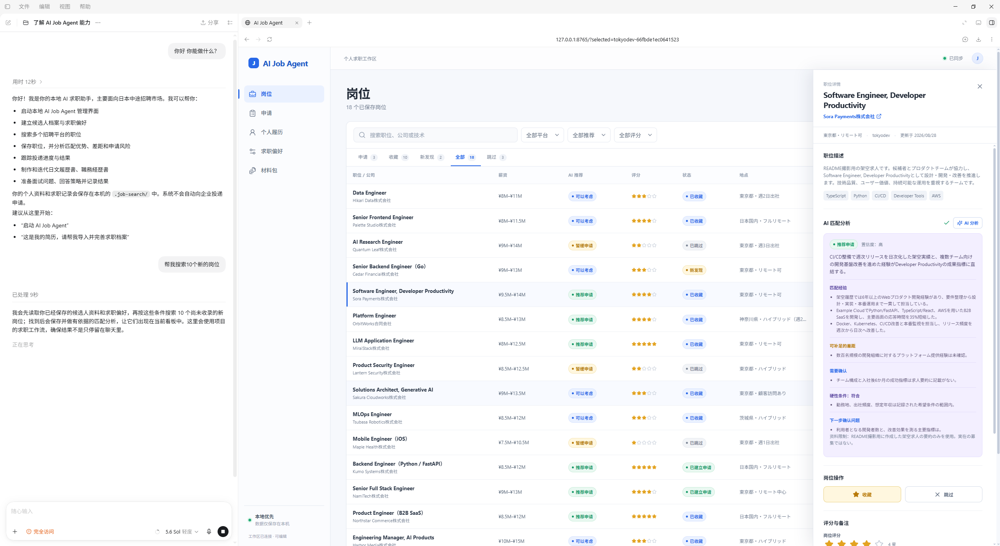

# AI Job Agent

[English](README.md) | [简体中文](README.zh.md) | 日本語

**日本での中途採用の転職活動のための、ローカルファーストなワークスペース。進捗は AI Job Agent で管理し、求人の検索、マッチ度の分析、日本語の応募書類の準備は Codex に任せます。**

AI Job Agent は、求人サイト、チャット履歴、フォルダに散らばった転職活動の情報を、ひとつのローカルワークスペースにまとめます。候補者の事実と希望条件、見つけた求人、応募、書類、提出記録を互いに結び付けて保持し、AI との会話を永続的な状態として扱いません。



> 現在、Web 画面の表示言語は中国語（簡体字）のみです。

## インストール

### 推奨：GitHub の URL を Codex に渡す

このリポジトリの GitHub ページの URL をコピーし、Codex のタスクを開いて次のように送信します。

> AI Job Agent をインストールして起動してください：`https://github.com/jah0m/ai-job-agent`

Codex が Python と Node.js/npm を確認し、リポジトリをクローンしてローカルセットアップを完了します。インストール後は、このプロジェクトを Codex で開いて次のように送信します。

> AI Job Agent を起動して

### 手動インストール

Python 3.11 以上と、Node.js 22 以上および npm が必要です。求人検索ツールとフロントエンドは、ルートの npm workspace を共有しています。

#### Windows（PowerShell）

```powershell
git clone https://github.com/jah0m/ai-job-agent.git
Set-Location ai-job-agent

python -m pip install -e ".[web]"

npm ci
npm run build:frontend

& '.agents\skills\job-search-web\scripts\start_web.ps1'
```

#### macOS（ターミナル）

`python3`、Node.js 22 以上、`npm` が使えることを確認してから実行します。

```bash
git clone https://github.com/jah0m/ai-job-agent.git
cd ai-job-agent

python3 -m venv .venv
source .venv/bin/activate
python -m pip install -e ".[web]"

npm ci
npm run build:frontend

python -m uvicorn ai_job_search.web:create_app \
  --factory --host 127.0.0.1 --port 8765
```

ターミナルを開いたまま `http://127.0.0.1:8765` にアクセスします。次回以降は、仮想環境を有効化して最後の `uvicorn` コマンドだけを実行します。

## はじめて使うとき

Codex はダッシュボードを本番モードで起動します。初回は次の順に進めます。

1. 候補者プロフィールを完成させる。
2. 希望職種、勤務地、働き方の希望、譲れない条件を設定する。
3. Codex に求人検索を依頼するか、公開されている求人 URL を貼り付けて直接取り込む。

詳しい流れは[はじめての利用ガイド](docs/user/first-use-guide.ja.md)を参照してください。リポジトリの開発に参加する場合は[開発と環境構築ガイド](docs/developer/development.md)（英語）を参照してください。

## できること

- **再利用できる候補者プロフィールの管理**：職歴、スキル、語学力、資格、根拠のある実績を保存します。
- **複数の公開ソースの検索**：Green、Geekly、LinkedIn、TokyoDev、LAPRAS、および HERP・HRMOS で公開されている企業の採用ページに対応しています。
- **求人とのマッチ度の評価**：確認済みの事実と希望条件にもとづき、根拠のある強み、分類されたギャップ、必須条件、未確認事項を示します。
- **企業ブラックリストの管理**：今後追わない企業を希望条件に登録し、以降の求人検索と一次選別で参照します。
- **選考全体の進捗管理**：保存した求人、見送った求人、書類準備、面接、内定、終了した応募までを追跡します。
- **求人ごとの職務経歴書の準備**：下書きの各リビジョンをたどれる状態で保持します。
- **自分で管理している定型の履歴書の保管**：PDF/DOCX をアップロードして保管します。Codex はこの書類を生成も編集もしません。
- **提出の証拠の保存**：最終版の PDF/DOCX をアップロードし、実際の提出経路と日時を記録すると、変更不可の書類パッケージが自動で作成されます。
- **面接準備と結果の記録**：保存された求人票、候補者の根拠、提出済みの書類をもとに準備します。

## 推奨ワークフロー

1. AI Job Agent で候補者プロフィールと希望条件を管理する。
2. Codex に適した求人サイトの検索を依頼するか、公開されている求人 URL を貼り付けて直接取り込み、保存する。
3. 元の求人票と、保存された AI のマッチ度分析を確認する。
4. 応募したい求人について応募記録を作成する。
5. Codex に、編集可能な「現在の書類」へ求人ごとの職務経歴書を準備してもらう。
6. Word、Google Docs、企業指定のテンプレート、または Markdown Resume Studio でレイアウトと書き出しを仕上げる。自分で管理している定型の履歴書がある場合は、ユーザー提供の書類として PDF/DOCX をアップロードする。
7. 企業の採用サイト、メール、または転職エージェント経由で提出する。
8. AI Job Agent に戻り、実際に使用したファイルと提出情報を記録する。

## 役割分担

| 担当 | 役割 |
| --- | --- |
| **AI Job Agent** | ローカルの求人、プロフィール、応募ステージ、現在の書類、書類パッケージ、提出記録を管理します。 |
| **Codex + Skills** | 公開求人の検索、マッチ度の評価、応募書類と面接内容の準備を行います。 |
| **外部の求人サイトやメール** | 実際の応募の提出とファイルの送信を行います。 |

AI Job Agent がユーザーに代わって応募を提出することはありません。また、書類の生成や提出の記録を、企業がファイルを受け取った証拠として扱うこともありません。現時点では PDF を生成しないため、最終的なレイアウトと書き出しは外部ツールで行います。

## ローカルデータとプライバシー

候補者データ、求人票、評価、応募履歴、生成した書類、アップロードしたファイル、SQLite データベース、コンテンツアドレス方式のオブジェクトは、すべてローカルマシンの `.job-search/` 配下に保存されます。このディレクトリは Git の管理対象外であり、個人の転職活動データがリポジトリに入ることはありません。

応募書類には明確なライフサイクルの境界があります。

- プロフィール、求人、評価、応募、状態、バージョン間の関係については、SQLite が唯一のメタデータの正本です。
- `objects/sha256/` には、求人票の証拠と書類の変更不可のコピーが 1 つだけ保存されます。
- 下書きを編集するたびに変更不可のリビジョンが作成され、パッケージと提出記録は正確なファイルハッシュを参照します。
- Codex の中間 JSON は `operations/` 配下に置かれ、保存に成功すると消去され、失敗した場合は診断用に残ります。

## ドキュメント

- **利用者向け**：[はじめての利用ガイド](docs/user/first-use-guide.ja.md)
- **開発者向け**（英語）：[開発と環境構築](docs/developer/development.md)、[アーキテクチャ](docs/developer/architecture.md)、[求人の検索と取り込み](docs/developer/job-ingestion.md)、[ストレージモデル](docs/developer/storage-model.md)
- **アーキテクチャ解説**：Codex、Web ダッシュボード、CLI の連携を示す[インタラクティブな全体図](https://jah0m.github.io/ai-job-agent/)
- **AI エージェント向け**（英語）：[リポジトリのルール](AGENTS.md)と[エージェントのワークフロー](.agents/README.md)

## プロジェクトの境界

- AI の分析は意思決定の補助であり、企業側の判断を表すものではありません。
- 求人サイトの認証、CAPTCHA、アクセス制限、レート制限を回避しません。
- 外部の応募フォームへの自動入力や自動提出は行いません。
- 重要なプロフィール情報を保存する前に、Codex が確認を求めます。
- 日本向けの応募準備で生成するのは、求人ごとの職務経歴書のみです。
- 自分で管理している定型の履歴書は、パッケージと提出の証拠として PDF/DOCX でアップロードできます。Codex がこれを生成または編集することはありません。

## License

[MIT](LICENSE)
