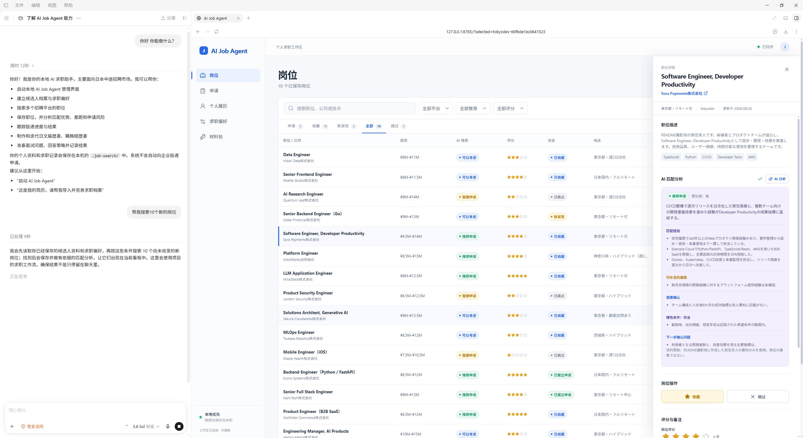

# AI Job Agent

English | [简体中文](README.zh.md)

**A local-first workspace for mid-career job searches in Japan: manage the process in AI Job Agent, and use Codex to find roles, evaluate fit, and prepare Japanese application materials.**

AI Job Agent brings information scattered across job boards, chat histories, and folders into one local workspace. It keeps candidate facts and preferences, discovered jobs, applications, materials, and submission records connected without treating an AI conversation as durable state.



## Installation

### Recommended: give the GitHub URL to Codex

Copy this repository's GitHub page URL, open a Codex task, and send:

> Install and start AI Job Agent: `https://github.com/jah0m/ai-job-agent`

Codex checks Python and Node.js/npm, clones the repository, and completes the local setup. After installation, open the project in Codex and send:

> Start AI Job Agent

### Manual installation

The project requires Python 3.11 or newer and Node.js 22 or newer with npm. The portal-search tools and frontend share the root npm workspace.

#### Windows (PowerShell)

```powershell
git clone https://github.com/jah0m/ai-job-agent.git
Set-Location ai-job-agent

python -m pip install -e ".[web]"

npm ci
npm run build:frontend

& '.agents\skills\job-search-web\scripts\start_web.ps1'
```

#### macOS (Terminal)

Make sure `python3`, Node.js 22 or newer, and `npm` are available, then run:

```bash
git clone https://github.com/jah0m/ai-job-agent.git
cd ai-job-agent

python3 -m venv .venv
source .venv/bin/activate
python -m pip install -e ".[web]"

npm ci
npm run build:frontend

python -m uvicorn ai_job_search.web:create_app \
  --factory --host 127.0.0.1 --port 8765
```

Keep the terminal open, then visit `http://127.0.0.1:8765`. On later runs,
activate the virtual environment and repeat only the final `uvicorn` command.

## First use

Codex starts the dashboard in production mode. On first use:

1. Complete the candidate profile.
2. Set target roles, locations, work-style preferences, and hard constraints.
3. Ask Codex to search for jobs, or paste a public job URL for direct import.

See the [first-use guide](docs/user/first-use-guide.md) for the complete workflow. Repository contributors should use the [development and setup guide](docs/developer/development.md).

## What you can do

- **Maintain a reusable candidate profile** with experience, skills, languages, certifications, and evidence-backed achievements.
- **Search multiple public sources**, including Green, Geekly, LinkedIn, TokyoDev, LAPRAS, and company pages hosted on HERP or HRMOS.
- **Evaluate job fit** using verified facts and preferences, with evidence-backed strengths, categorized gaps, hard constraints, and open questions.
- **Track the full pipeline** across saved jobs, skipped roles, material preparation, interviews, offers, and closed applications.
- **Prepare Japanese application materials** with job-specific 履歴書 and 職務経歴書 drafts whose revisions remain traceable.
- **Preserve submission evidence** by uploading final PDF/DOCX files, recording the real channel and time, and automatically creating an immutable material package.
- **Prepare for interviews and record outcomes** using the archived posting, candidate evidence, and submitted materials.

## Recommended workflow

1. Maintain the candidate profile and search preferences in AI Job Agent.
2. Ask Codex to search suitable portals, or paste a public job URL to import and save it directly.
3. Review the original posting and persisted AI fit analysis.
4. Create an application record for a role worth pursuing.
5. Ask Codex to prepare 履歴書 and 職務経歴書 in the mutable current materials.
6. Finish layout and export in Word, Google Docs, an employer template, or Markdown Resume Studio.
7. Submit through the employer site, email, or recruiting agent.
8. Return to AI Job Agent and record the files and metadata that were actually used.

## Responsibilities

| Surface | Responsibility |
| --- | --- |
| **AI Job Agent** | Manage local jobs, profiles, application stages, current materials, material packages, and submission records. |
| **Codex + Skills** | Search public listings, evaluate fit, and prepare application and interview content. |
| **External portal or email** | Perform the real application submission and file transfer. |

AI Job Agent never submits an application on the user's behalf and never treats generating materials or recording a submission as proof that an employer received files. It does not currently generate PDFs; final layout and export happen in external tools.

## Local data and privacy

Candidate data, job postings, evaluations, application history, generated materials, uploaded files, the SQLite database, and content-addressed objects remain on the local machine under `.job-search/`. The directory is ignored by Git so private job-search data does not enter the repository.

Application materials have explicit lifecycle boundaries:

- SQLite is the sole metadata authority for profiles, jobs, evaluations,
  applications, state, and version relationships;
- `objects/sha256/` stores one immutable copy of posting evidence and materials;
- draft edits create immutable revisions, while packages and submissions refer
  to exact artifact hashes;
- Codex staging JSON lives under `operations/`, is consumed after successful
  persistence, and remains after failure for diagnosis.

## Documentation

- **Users:** [first-use guide](docs/user/first-use-guide.md)
- **Developers:** [development and setup](docs/developer/development.md), [architecture](docs/developer/architecture.md), [job discovery and ingestion](docs/developer/job-ingestion.md), and [storage model](docs/developer/storage-model.md)
- **AI agents:** [repository rules](AGENTS.md) and [agent workflows](.agents/README.md)

## Project boundaries

- AI analysis assists decision-making; it does not represent an employer's judgment.
- Portal workflows do not bypass authentication, CAPTCHAs, access controls, or rate limits.
- The project does not automatically fill or submit external application forms.
- Codex asks for confirmation before saving important profile information.
- Japanese applications include both a 履歴書 and 職務経歴書 by default unless the role or user requires otherwise.

## License

[MIT](LICENSE).
